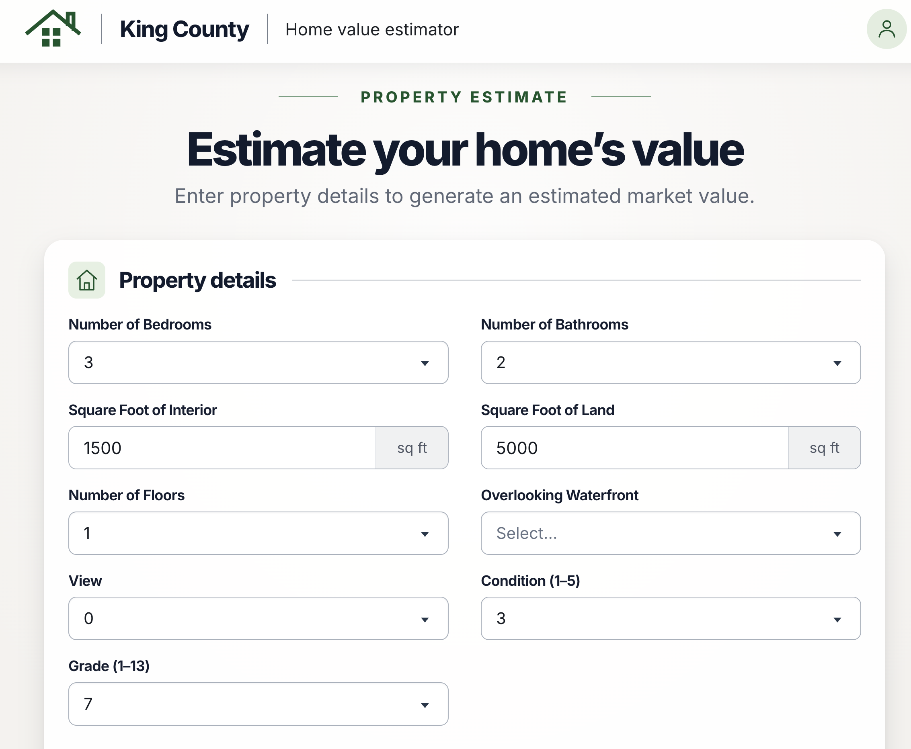

# House Price Prediction with Machine Learning

This project utilizes the King County Housing Kaggle dataset to construct a house price prediction system. The system aids homeowners, buyers, and real estate agents in determining the estimated price of a house in King County.

## Model

The price prediction model was developed using Random Forest, a popular machine learning algorithm devised by Leo Breiman and Adele Cutler. Random Forest combines the outputs of multiple decision trees to produce a single result. Its simplicity and versatility have led to widespread adoption, making it suitable for both classification and regression tasks.

## Web Dashboard

Additionally, the model is integrated into a user-friendly web dashboard. This dashboard facilitates the prediction of house prices, providing an intuitive interface for users.
[house price prediction app](https://project2group-k.onrender.com/)

